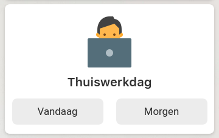
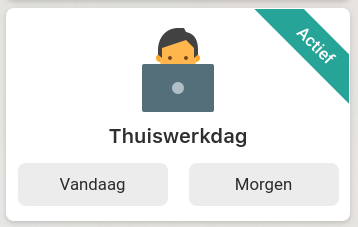

# My Custom Button Card Templates

These are some templates I designed using the [awesome custom button card](https://github.com/custom-cards/button-card), the one Home Assistant card to rule them all.

### Big Tile with 2 child buttons and state banner
The most interesting bit is not so much the child buttons, but the design of the state of the entity as a banner/label in the top right corner of the card, thus giving you a quick glance on the toggled state of a script/automation/entity.

| Inactive state | Active state
| --- | ---
|  | 
