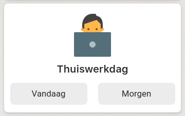
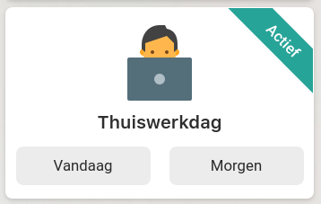
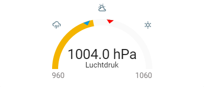
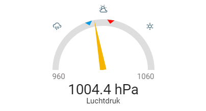
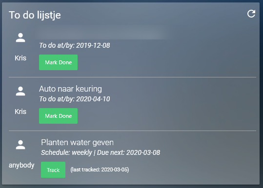

# My custom Home Assistant Lovelace cards

## Button card templates
These are some templates I designed using the [awesome custom button card](https://github.com/custom-cards/button-card), the one Home Assistant card to rule them all.

### Big Tile with 2 child buttons and state banner
The most interesting bit is not so much the child buttons, but the design of the state of the entity as a banner/label in the top right corner of the card, thus giving you a quick glance on the toggled state of a script/automation/entity.

| Inactive state | Active state
| --- | ---
|  | 

## Deprecated cards
I no longer use nor maintain these cards, just leaving them up for refrence.

### nmbs-myroute-card
A card to display the next trains leaving a Belgian train station for a given route.

| Standard (no styling) | Styled
| --- | ---
|  | 

[More info](nmbs-routeboard/)

### barometer-gauge-card
A card for air pressure sensors that's styled as a barometer.

| Standard style | Needle style
| --- | ---
|  | 

[More info](barometer-gauge/)

### grocy-chores-tasks-card
A card that shows you the tasks and chores you have entered in Grocy and allows you to interact with them.

| Screenshot
| --- 
|  

[More info](grocy-chores-tasks/)